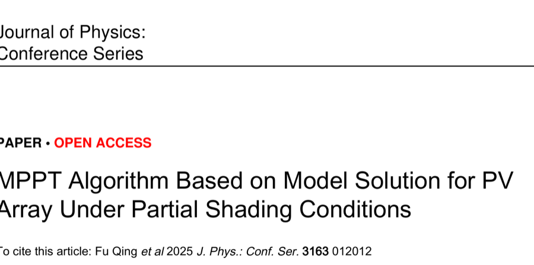
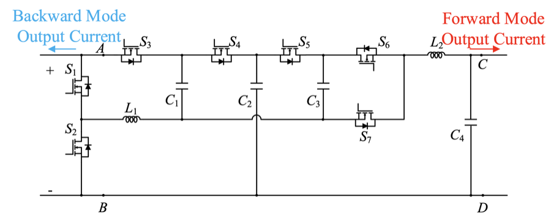
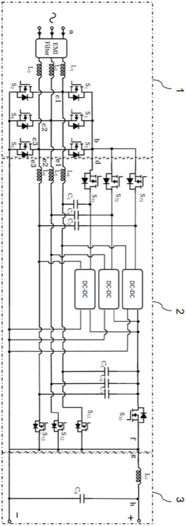
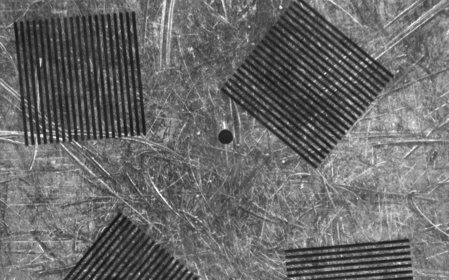
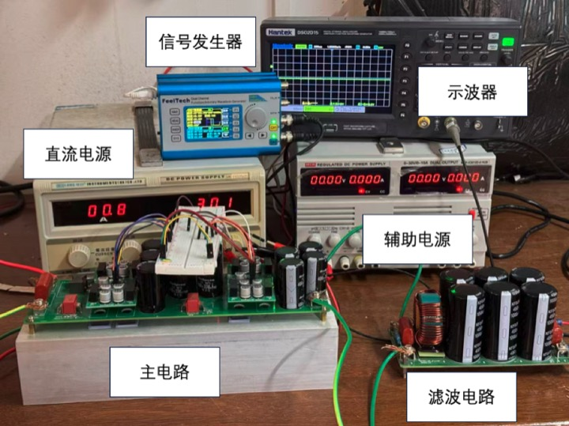
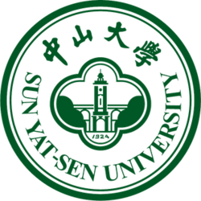

## About Me

I am an M.Sc. student in Robotics at the [National University of Singapore](https://nus.edu.sg/), where I also work as a student helper in the G&M Lab, led by Asst. Prof. Jianshu Zhou. I focus on **embodied AI** and **robot learning**. I received my B.Sc. in Opto-Electronics Information Science and Engineering from [Sun Yat-sen University (SYSU)](https://www.sysu.edu.cn/).

My research focuses on teaching robots to act in the physical world — vision-language-action (VLA) models, imitation learning, dexterous manipulation, and high-DoF teleoperation for contact-rich tasks. I enjoy building full-stack systems that span from low-level motor control and IK solvers to end-to-end learned policies.

## Research Interests

- **Embodied AI & Robot Learning:** VLA models, imitation learning (ACT, SmolVLA), few-shot policy learning
- **Dexterous Manipulation:** contact-rich tasks, tactile-visual fusion, multi-fingered hands
- **Teleoperation & Data Collection:** bimanual glove/tracker retargeting, VR teleoperation, real-time IK

## News

- **[Jul. 2026]** Started my research on high-DoF teleoperation for contact-rich dexterous manipulation.
- **[Jul. 3, 2026]** Joined the G&M Lab at NUS, led by Asst. Prof. Jianshu Zhou.
- **[Jun. 24, 2026]** Graduated from Sun Yat-sen University with a B.Sc. degree.
- **[Jan. 2026]** Began a Software Engineering internship at Ronovo Surgical, building VR teleoperation for surgical robots.
- **[Nov. 2025]** Started work on VLA fine-tuning and tactile-visual fusion with the SO-ARM101 platform.

## Publications & Patents

<ol class="bibliography">

<li>

  

    
    <abbr class="badge">JPCS</abbr>
  

  

    
MPPT Algorithm Based on Model Solution for PV Array Under Partial Shading Conditions

    
Fu Qing, Yiqi Zeng, <strong>Haoming Liu</strong>, Yuan Jing, Xiaoping Zhou

    
<em>ICESI 2025, Journal of Physics: Conference Series, vol. 3163, 012012.</em>

    

      <a href="https://doi.org/10.1088/1742-6596/3163/1/012012" class="btn btn-sm z-depth-0" role="button" target="_blank" style="font-size:12px;">DOI</a>
    

  

</li>
 

<li>

  

    
    <abbr class="badge">Patent</abbr>
  

  

    
A V2G Bidirectional DC-DC Converter Circuit

    
<strong>Haoming Liu</strong> et al.

    
<em>Chinese Invention Patent, CN119134906A. Granted, Sep. 2024.</em>

  

</li>
 

<li>

  

    
    <abbr class="badge">Patent</abbr>
  

  

    
A V2G Bidirectional AC-DC Converter Based on Hybrid AC-DC Topology and Its Control Strategy

    
<strong>Haoming Liu</strong> et al.

    
<em>Chinese Invention Patent, CN120377691A. Under examination, Jul. 2025.</em>

  

</li>
 

</ol>

## Research

<ol class="bibliography">

<li>

  

    
High-DoF Teleoperation for Contact-Rich Dexterous Manipulation

    
Haoming Liu

    
<em>National University of Singapore, 2026 – Present</em>

    
Bimanual teleoperation system with two decoupled paths — MANUS gloves → 20-DoF Wuji dexterous hands, and VIVE trackers → Franka via cuRobo IK — for imitation-learning data collection. Built an analytical-gradient IK retargeting pipeline mapping 21-keypoint glove input to 20-DoF joint angles at ~50 ms latency over ROS 2.

  

</li>
 

<li>

  

    
Robotic Arm Control & VLA Fine-Tuning (SO-ARM101)

    
Haoming Liu

    
<em>2025 – 2026</em>

    
End-to-end imitation-learning system on ROS 2 + MoveIt 2 with RRT* planning. Trained ACT/SmolVLA policies from 50+ expert demonstrations; fused FlexiTac-V2 tactile pressure maps with visual observations, improving real-robot grasping success by 30% over a vision-only baseline (60% pick-and-place success).

  

</li>
 

<li>

  

    
  

  

    
Micro-Hole Inspection via Optical Swept-Source Interferometry

    
Haoming Liu

    
<em>National University Students' Optoelectronic Design Competition (3rd Prize), 2025 – Present</em>

    
Built and compared a free-space Michelson white-light interferometer and a fiber-optic Mach-Zehnder (MZ) swept-source interferometer, selecting the fiber-optic setup for its higher signal-to-noise ratio. Applied real-time FFT to the detector's time-domain signal to recover the depth-resolved reflectivity profile (swept-source interferometry), increasing measurement speed while eliminating mechanical scanning — achieving a single-measurement time of ≤ 160 s, a depth range of 4.56 mm, and a depth error of ≤ 6.9 µm. Estimated hole diameter from a three-point circle fit of tracked edge points.

  

</li>
 

<li>

  

    <video class="teaser img-fluid z-depth-1" style="width:100%" muted autoplay loop playsinline poster="./assets/img/proj_mecanum_poster.jpg">
      <source src="./assets/videos/proj_mecanum.mp4" type="video/mp4">
    </video>
  

  

    
Omnidirectional Intelligent Vehicle (Mecanum Wheels)

    
Haoming Liu

    
<em>2024</em>

    
Distributed upper/lower control architecture: Raspberry Pi running ROS 2 for LiDAR SLAM (slam_toolbox) and Navigation2 global/local planning; STM32F103 for encoder PID closed-loop motor control with IMU heading correction.

  

</li>
 

<li>

  

    
  

  

    
Multimodal Efficient Power Conversion for Electric Vehicles

    
Haoming Liu

    
<em>2023 – 2025</em>

    
High-efficiency Buck-Boost + charge-pump DC-DC converter supporting four modes (boost/buck charging, V2G grid feedback). Achieved 100V→250V boost and 400V→200V buck at up to 500W. <strong>2 invention patents filed (published)</strong>; recognized as a university-level Outstanding Innovation & Entrepreneurship Project.

  

</li>
 

</ol>

## Experience

- **Ronovo Surgical** — Software Engineering Intern, Shanghai *(Jan. 2026 – May 2026)* 
  Built a Pico-headset VR teleoperation system for surgical robots (XR tracking → DDS comms → stereo video feedback, 50–100 ms latency). Developed an RCM-constrained IK solver in MuJoCo with null-space singularity avoidance and gravity compensation.

## Honors & Awards

- **SYSU Outstanding Student Scholarship**, 2nd Prize (top 15%) — 2023 & 2024
- **37 Interactive Entertainment Undergraduate Leadership Scholarship** — 2024
- **National University Students' Optoelectronic Design Competition**, 3rd Prize — 2025
- **National Competition in Science & Technology on Renewable Energy for College Students**, 3rd Prize — 2025

## Education

  
  

    <strong>National University of Singapore</strong> 
    M.Sc. in Robotics <em>(Present)</em>
  

  
  

    <strong>Sun Yat-sen University</strong> 
    B.Sc. in Opto-Electronics Information Science and Engineering <em>(2022 – 2026)</em>
  

## Skills

**Programming & Tools:** Python, MATLAB, PSIM, PyTorch, Isaac Lab, MuJoCo 
**Languages:** Mandarin (native), Cantonese (native), English (fluent, IELTS 7.5)
